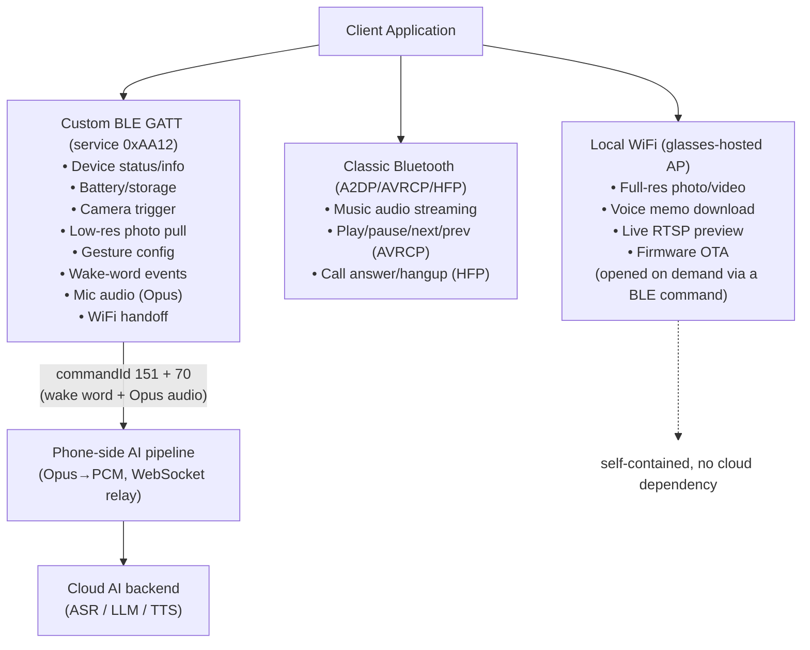
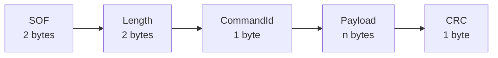
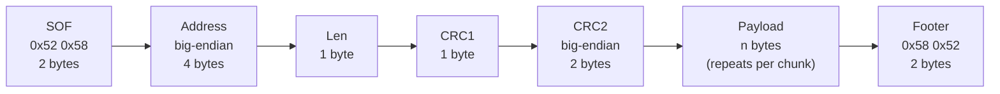
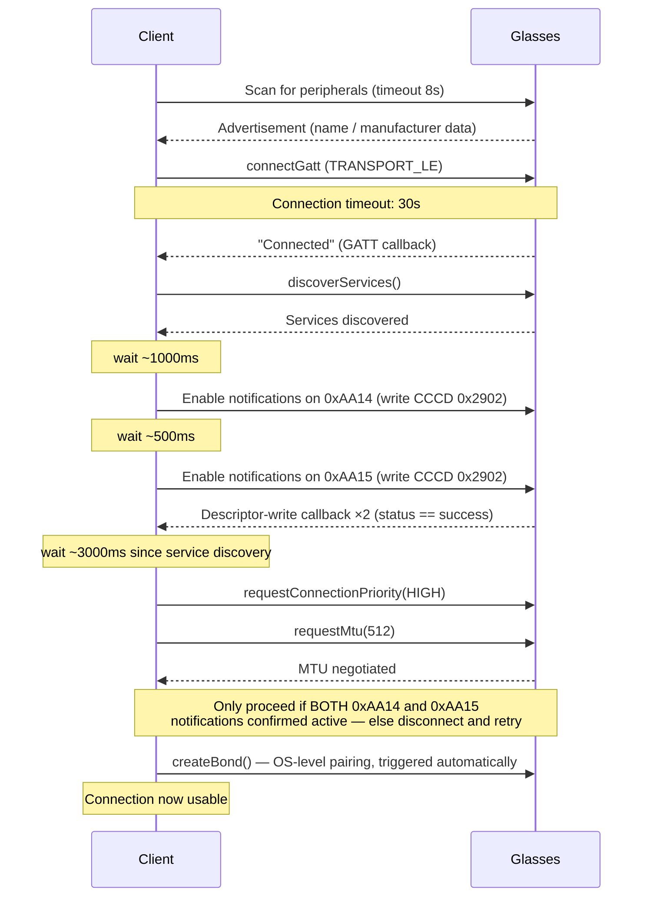
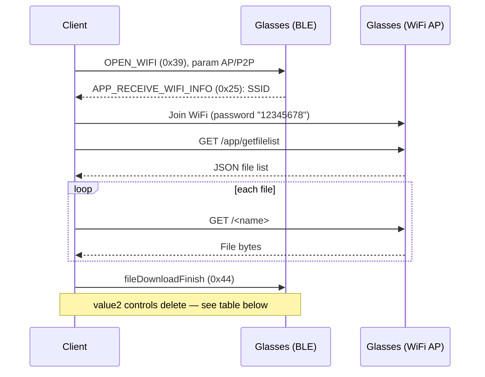
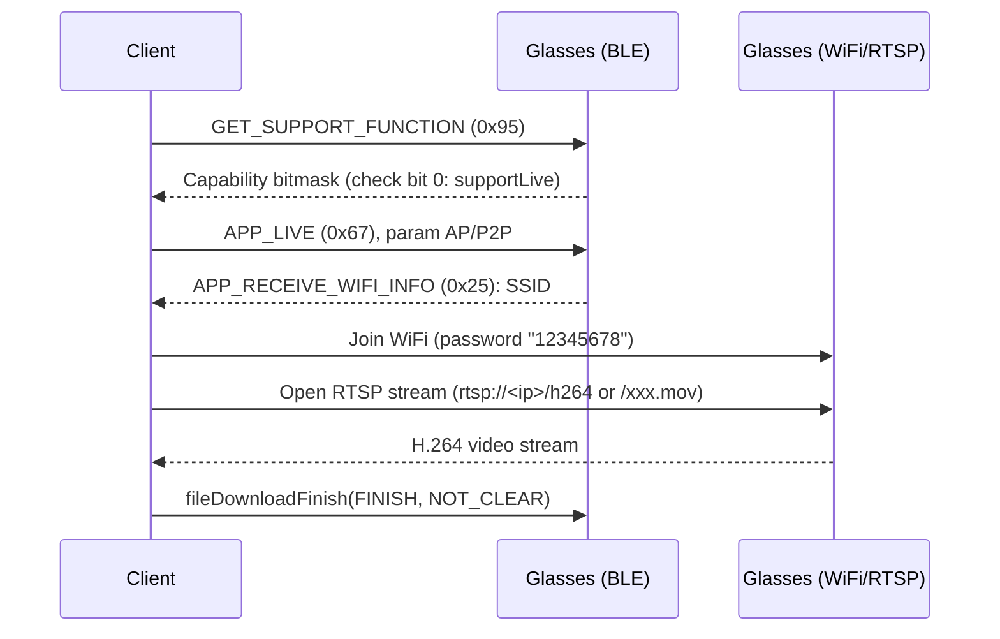
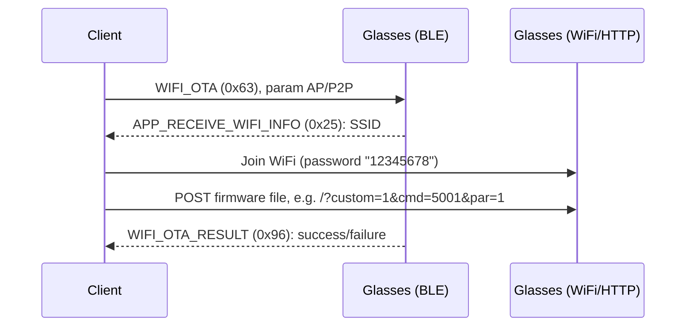
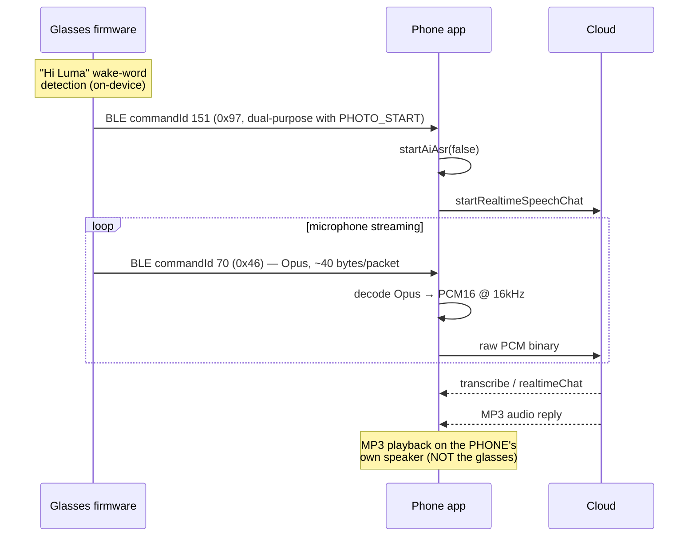

# Eyevue Smart Glasses (E09) — BLE Protocol & AI Assistant Developer Reference

**Target hardware:** Eyevue "Smart Glasses E09" (and OEM/rebrand variants)
**Reference application:** Eyevue Glass App v1.0.65-gp (Android), cross-checked against the official iOS app where noted
**Document version:** 2.1
**Status:** Reverse-engineered reference, empirically validated against real hardware where marked ⭐. Read the [Disclaimer](#disclaimer) before relying on this for production integration.

**v2.1 change note:** §8.1/§8.3 revised — a passive-listen capture during physical gesture testing showed real, spontaneous BLE notifications (`ACTION_SYNC`, `APP_RECEIVE_SOUND`, and a genuine `TAKE_PHOTO` execution + `APP_RECEIVE_THUMBNAIL_COUNT` push) correlated with gesture actions, with no classic-Bluetooth connection active. The v2.0 claim that gesture-triggered actions are entirely invisible to the custom BLE service and only observable via classic-Bluetooth AVRCP/HFP was too broad — corrected below, with the narrower claim (the gesture-*configuration* commandIds `0x07`–`0x11` themselves never notify) still standing.

---

## About this document

This is a from-scratch reference for engineers building an alternative client (mobile, desktop, or embedded) for Eyevue's E09 smart glasses. It documents every wire protocol the glasses speak, every command and payload format, and the four independent communication channels a full-featured client needs to implement:

1. **A custom BLE GATT protocol** — the primary control channel: device status, camera trigger, gesture configuration, low-res photo preview, wake-word events, microphone audio streaming.
2. **Classic Bluetooth (A2DP + AVRCP + HFP)** — standard Bluetooth audio/media-control/telephony profiles, paired separately from the BLE GATT connection, used for actual audio playback and for gesture-triggered media/call control.
3. **A locally-hosted WiFi network with an HTTP/RTSP API** — opened on demand by the glasses, used for full-resolution photo/video/audio-memo import, live camera preview streaming, and firmware OTA updates.
4. **A cloud AI backend over WebSocket** — powers the "Hi Luma" wake-word voice assistant: speech recognition, scene description, conversational replies, and text-to-speech, all off-device.

This material was produced by decompiling and reading the reference Android app in full (not a partial/heuristic scan) and cross-validating the resulting protocol model against real hardware using a purpose-built macOS test tool (`app/tools/ble_probe/`, documented in [§13](#13-testing--validation-tooling)). Findings marked ⭐ were confirmed on physical hardware; everything else is a direct, verified reading of the shipped app's logic and should be treated as "what the reference app does," not as an official spec.

---

## Table of Contents

1. [Architecture Overview](#1-architecture-overview)
2. [BLE Fundamentals](#2-ble-fundamentals) — services, characteristics, frame formats, CRC
3. [BLE Connection Lifecycle](#3-ble-connection-lifecycle)
4. [Command Reference](#4-command-reference) — the complete command table
5. [Payload Data Structures](#5-payload-data-structures) — the "Beans"
6. [Feature Guide: Device Status, Battery & Storage](#6-feature-guide-device-status-battery--storage)
7. [Feature Guide: Camera — Photo & Video](#7-feature-guide-camera--photo--video)
8. [Feature Guide: Gestures & Classic Bluetooth Media/Call Control](#8-feature-guide-gestures--classic-bluetooth-mediacall-control)
9. [Feature Guide: Local Voice Memos](#9-feature-guide-local-voice-memos)
10. [Feature Guide: WiFi Channel — Media Import, Live Preview, OTA](#10-feature-guide-wifi-channel--media-import-live-preview-ota)
11. [Feature Guide: The "Hi Luma" AI Voice Assistant](#11-feature-guide-the-hi-luma-ai-voice-assistant)
12. [Reference Implementation Snippets](#12-reference-implementation-snippets)
13. [Testing & Validation Tooling](#13-testing--validation-tooling)
14. [Known Firmware/App Quirks & Gotchas](#14-known-firmwareapp-quirks--gotchas)
15. [Appendix A: Complete Command & Parameter Tables](#appendix-a-complete-command--parameter-tables)
16. [Appendix B: Glossary](#appendix-b-glossary)
17. [Appendix C: Source File Index](#appendix-c-source-file-index)
18. [Disclaimer](#disclaimer)

---

## 1. Architecture Overview

A client application talks to the glasses over four independent transports. Understanding which transport owns which feature up front will save you from looking for functionality in the wrong place.



**Key architectural facts every implementer should internalize before writing code:**

- **The custom BLE GATT service never carries full-resolution media.** The photo transfer visible on the BLE photo-notify characteristic is a low-resolution preview (observed: 320×180) intended for a quick look, not for saving. Full-resolution photos/videos, and any voice memo recorded to local storage, are only retrievable over the WiFi channel (§10).
- **The BLE gesture commands (`0x07`–`0x11`) only configure which action a physical gesture triggers — they never notify live.** But this does **not** mean gesture-triggered actions are invisible to BLE altogether: performing a gesture has been confirmed, via passive listening with no classic-Bluetooth connection active, to produce real spontaneous notifications on *other* commandIds — `ACTION_SYNC` (`0x45`) flag pulses, an `APP_RECEIVE_SOUND` (`0x69`) volume-value push, and in one observed case a genuine `TAKE_PHOTO` (`0x22`) execution plus an `APP_RECEIVE_THUMBNAIL_COUNT` (`0x42`) push (§8.1.1). Classic Bluetooth AVRCP/HFP (§8.3) is still believed to be how phone-side media-app control is delivered, but it is not the *only* channel through which a gesture's effect becomes observable.
- **The wake-word voice assistant is not self-contained on the glasses.** Wake-word *detection* is on-device (glasses firmware), but everything after that — speech recognition, understanding, generating a reply, and synthesizing speech — happens in the cloud, reached via a WebSocket relay running in the phone app. The audio reply is played back through the *phone's* speaker, not the glasses (§11).
- **The BLE CRC is a modulo-256 byte sum, not a polynomial CRC** (§2.4), and is inconsistently checked (never validated on the receive path for file transfers, §5).
- **Two distinct hardware/provisioning variants exist** ("AP" and "P2P" WiFi modes), selected server-side per device/customer, not detected by the client at runtime (§10.1). On the unit used for empirical validation in this document, both variants converge to identical behavior — see the callout in §10.1.

---

## 2. BLE Fundamentals

### 2.1 GATT Services & Characteristics

| UUID | Role | Properties |
|---|---|---|
| `0000aa12-0000-1000-8000-00805F9B34FB` | **Primary custom service** | — |
| `0000aa13-0000-1000-8000-00805F9B34FB` | Command write | write |
| `0000aa14-0000-1000-8000-00805F9B34FB` | Command notify | notify |
| `0000aa15-0000-1000-8000-00805F9B34FB` | Photo/file-transfer notify | notify |
| `00002902-0000-1000-8000-00805f9b34fb` | Client Characteristic Configuration (standard) | — |

Write commands to `0xAA13`. Command responses/notifications (device status, wake-word events, gesture config, Opus audio) arrive on `0xAA14`. Photo file-transfer frames arrive on `0xAA15` using a **different frame format** from everything else on `0xAA14` (§2.3.2) — do not attempt to parse `0xAA15` traffic with the command-frame parser.

Two additional GATT services are advertised but are **not** part of the protocol documented here:

- **`0000180F-...` (standard Bluetooth SIG Battery Service)**, with the standard `0x2A19` Battery Level characteristic (read+notify). ⭐ Confirmed present on real hardware. Not referenced anywhere in the reference app — it uses its own proprietary `GET_BATTERY` command instead (§6). Practical implication: **any generic BLE tool, including a phone's own Bluetooth settings, can read battery level without knowing this protocol at all.**
- **`AE00` with characteristics `AE01` (write-without-response) and `AE02` (notify)** ⭐ confirmed present on real hardware, absent from the app's Java source entirely. Almost certainly the GATT service of the vendored **Jieli Bluetooth chipset OTA SDK** (§10.4), which communicates at a native platform level below the app's own `Command`/`Datagram` abstractions. Contents unconfirmed.

Two Bluetooth **classic** (BR/EDR) profile UUIDs are also referenced by the app for the separate classic-Bluetooth audio connection (§8):

| UUID | Profile |
|---|---|
| `00001101-0000-1000-8000-00805f9b34fb` | SPP (Serial Port Profile) |
| `0000111e-0000-1000-8000-00805f9b34fb` | HFP (Hands-Free Profile — calls) |
| `0000110b-0000-1000-8000-00805f9b34fb` | A2DP (Advanced Audio Distribution Profile — music) |

### 2.2 Command-Channel Frame Format (`0xAA13`/`0xAA14`)



- **SOF** — 2 bytes. **`0xAB 0x55`** for client→glasses frames, **`0xAC 0x55`** for glasses→client frames (i.e. the high byte increments by one between directions, low byte stays `0x55`).
- **Length** — 2 bytes, big-endian. Counts `commandId + payload + crc` (i.e. does **not** include the SOF or itself).
- **CommandId** — 1 byte. See [§4](#4-command-reference).
- **Payload** — `n` bytes, `n = length - 2`.
- **CRC** — 1 byte. See §2.4.

Minimal example — `GET_BATTERY` (commandId `0x17`), no payload:

```
0xAB 0x55 0x00 0x02 0x17 0x17
└SOF─┘ └Len:2┘ │cmd │crc
                (commandId+crc, no payload)
```

⭐ Confirmed on real hardware — request/response pair:

```
Request:  0xAB 0x55 0x00 0x03 0x17 0x00 0x17
Response: 0xAC 0x55 0x00 0x05 0x17 0x38 0x36 0x00 0x85
```

### 2.3 File-Transfer Frame Format (`0xAA15`)

Photo transfer (and, per the app's own file-transfer constant naming, potentially other file transfers) uses a structurally different frame, confirmed present on real hardware:



- **SOF**: `0x52 0x58` (also used, separately, as the SOF for a legacy/unused SPP transport on the command channel — unrelated to file transfer despite sharing the same magic bytes).
- **Address**: 4 bytes, big-endian — meaning device-specific, not confirmed on this channel.
- **Len**: 1 byte.
- **CRC1**: 1 byte — sum of `[0x52, 0x58, address (4 bytes), len]` mod 256. Covers the header, never the payload.
- **CRC2**: 2 bytes, big-endian — a *separate* checksum over the payload only (algorithm not fully confirmed; treat as informational, since the receive path never validates it — see below).
- **Footer**: literal bytes `0x58 0x52` terminate every frame.

⭐ Confirmed on real hardware — a `PHOTO_START` frame:

```
0x52 0x58 0x00 0x07 0x97 0x00 0x00 0x2F 0xB8 0x02 0x80 0x58 0x52
```

**Critical implementation note:** the reference app's receive path (`recoverBytesToDatagram` for this frame type) does **not** validate CRC1 or CRC2 at all — it only extracts `len`, `commandId`, and `payload`, trusting the data as-is. If you're writing a receiver, you can skip CRC validation and still match reference behavior, but if you're implementing a sender (e.g. emulating glasses firmware for testing), you should still compute correct CRCs since real hardware might validate them even though the reference client doesn't.

### 2.4 CRC Algorithm

The command-channel CRC (§2.2) is a **simple additive checksum**, not a polynomial CRC:

```
CRC = (commandId + Σ payload_bytes) & 0xFF
```

It covers `commandId + payload` only — **never** the SOF or length fields.

Reference implementation:

```java
public static byte calculateCrc(int commandId, byte[] payload) {
    int crc = commandId;
    if (payload != null) {
        for (byte b : payload) {
            crc += (b & 0xFF);
        }
    }
    return (byte) (crc & 0xFF);
}
```

Worked example — `GET_BATTERY` (`0x17`), no payload: `CRC = 0x17 & 0xFF = 0x17`.

The file-transfer channel (§2.3) uses an unrelated, two-part CRC scheme (CRC1 over the header, CRC2 over the payload) that is never checked on receive — see the implementation note above.

---

## 3. BLE Connection Lifecycle

Implement this sequence; skipping the delays or the notification-confirmation gating below has been observed (in the reference app itself) to cause connections that appear established but silently drop commands.



**MTU note:** request an MTU of 512 bytes. A different, unrelated part of the app's OTA subsystem (for updating the Bluetooth chipset's own firmware, not the glasses' main firmware) computes usable payload size as `MTU - 3`, clamped between 20 and 509 bytes — that clamping is specific to that OTA transport and not part of the general command protocol.

**Command send discipline** (reference app behavior, worth replicating for compatibility):
- Queue writes; don't fire them concurrently.
- Retry a failed write up to 3 times, with a 100ms delay between attempts, before giving up on that specific write and moving to the next queued one.
- Enforce a minimum 50ms gap between consecutive writes.
- Apply a 2-second timeout for "no response to this command" at the application level, distinct from the lower-level write-retry timeout above — these are two separate mechanisms in the reference app and are not reconciled with each other.

---

## 4. Command Reference

Every command is a single-byte `commandId` (declared as a 32-bit int in the source, but always used as a byte 0x00–0xFF). The full table of all 65 commands and 89 parameter values is in [Appendix A](#appendix-a-complete-command--parameter-tables) — this section covers usage patterns and groups commands by purpose. Read this section for *how* to use them; use Appendix A as the lookup table.

### 4.1 A protocol quirk you need to know before reading the table: same-ID request/response pairs

For several commands, the glasses echo the **same commandId** back as the response, distinguished only by which byte value comes in the SOF (`0xAB55` you-sent-it vs `0xAC55` they-sent-it-back), not by a different response ID:

- `GET_BATTERY` (`0x17`) request → response, same ID, different payload (§6).
- `GET_CAPACITY` (`0x16`) request → response, same ID.
- `APP_GET_DEVICE_STATUS` (`0x48`) request → response, same ID — and this is also how gesture-action assignments are read back (§8).
- `APP_RECEIVE_DEVICE_INFO`/`CUSTOMER_PID_VID`/`APP_RECEIVE_SOUND` (`0x55`/`0x64`/`0x69`) — Appendix A's "Type" column lists these as glasses→app only, but the reference app also sends them as zero-effort queries to request that same data. If you send a payload-less frame with one of these commandIds, you're asking the glasses to report their current value for that ID, not commanding anything.

Separately, three commandId values are **triple/double-aliased** with entirely unrelated meanings depending on which characteristic/context they arrive on:

| Value | Meaning on `0xAA15` (file-transfer channel) | Meaning on `0xAA14` (command channel) |
|---|---|---|
| `0x97` (151) | `PHOTO_START` — begin photo reassembly | Wake-word event marker; also `APP_PULL_HIGH_QUALITY_STATUS` |
| `0x98` (152) | `PHOTO_TRANS` — photo data chunk | `APP_RECEIVE_THUMBNAIL_DATA_START` |
| `0x99` (153) | `PHOTO_END` — photo transfer complete | Voice-stream-end marker; also `APP_RECEIVE_VOICE_DATA_END` |

This is not a bug to work around — it's a deliberate (if confusing) design choice in the firmware: **the same numeric marker means "photo chunk" on the file-transfer characteristic and "voice-assistant lifecycle event" on the command characteristic.** Always dispatch based on which characteristic the notification arrived on before interpreting the commandId.

Finally, six gesture-related commandIds (`0x07`,`0x08`,`0x09`,`0x10`,`0x11`,`0x43`) are configuration read/write IDs, not live physical-gesture-event notifications — see §8 before assuming otherwise; this is a common misreading of the command table's "Type" column.

### 4.2 Commands grouped by feature

| Group | CommandIds | See |
|---|---|---|
| Device info, battery, storage | `0x16`,`0x17`,`0x48`,`0x55`,`0x54`,`0x64`,`0x65`,`0x95` | §6 |
| Photo/video capture & BLE preview transfer | `0x22`,`0x23`,`0x24`,`0x35`,`0x36`,`0x37`,`0x40`,`0x42`,`0x50`,`0x61`,`0x97`,`0x98`,`0x99` | §7 |
| Gestures & physical config | `0x07`,`0x08`,`0x09`,`0x10`,`0x11`,`0x43` | §8 |
| Classic-Bluetooth media/call/audio | `0x30`,`0x31`,`0x32`,`0x33`,`0x68`,`0x69`,`0x70` | §8 |
| Local voice memo | `0x34` | §9 |
| WiFi (media import, live preview, OTA) | `0x39`,`0x25`,`0x44`,`0x63`,`0x66`,`0x67`,`0x96` | §10 |
| Wake word & AI voice assistant | `0x06`,`0x0A`,`0x46`,`0x49`,`0x51`,`0x56`,`0x57`,`0x71`,`0x72` | §11 |
| Basic device settings | `0x01`,`0x02`,`0x03`,`0x04`,`0x62` | misc, see Appendix A |
| Sync/status stream | `0x45` | §7.4 |
| Misc / factory | `0x14`,`0x15`,`0x59` | Appendix A |

---

## 5. Payload Data Structures

Payloads are decoded/encoded by small serialization classes (referred to throughout this document by their reference-app name, "Beans," since that's how you'll find them if you go source-diving yourself). Two generic ones cover the majority of commands:

- **Single-byte value** (`CommonBean` equivalent): payload is exactly 1 byte, a raw integer 0-255.
- **Two-byte value** (`Common2Bean` equivalent): payload is exactly 2 bytes, `[value1, value2]`, each a raw integer — **not** a combined 16-bit integer. ⚠️ The reference app does not validate a second byte is present before reading it; a 1-byte payload where 2 are expected throws in the reference implementation. Guard against this in your own parser.

Command-specific structures:

| Structure | Fields | Encoding | Used by (commandId) |
|---|---|---|---|
| Battery (query response) | `value` (0-100), `isCharging` | **BCD-by-nibble**: `value = ((b0 & 0x0F)*10) + (b1 & 0x0F)`; `isCharging = (b2 == 1)` | `0x17` response |
| Battery (spontaneous push) | `isCharging`, `value` (0-255 raw) | ⚠️ Different encoding & field order from above: `isCharging = (b0==1)`, `value = b1` raw (not BCD) | `0x53` |
| Device firmware info | `btVersion`, `deviceVersion`, `ispVersion` | `btVersion = "b0.b1.b2"`, `ispVersion = "b3.b4.b5"`, `deviceVersion = b6` (7 bytes total) | `0x55` |
| Storage capacity | raw value | ⭐ 2 bytes big-endian (not 4, despite looking like it should be a 32-bit int) — unit unconfirmed | `0x16` response |
| 16-bit value | `value` | 2 bytes big-endian: `value = (b0<<8)\|b1` | `0x40`/`0x42` (thumbnail count) |
| WiFi SSID | `ssid` (String) | Raw UTF-8, trailing zero-padding stripped | `0x25` |
| Customer/PID-VID | `project`, `customer` (String) | ≥8 bytes: first 4 → `project`, next 4 → `customer`, each null-stripped then UTF-8 decoded | `0x64` |
| Camera direction | `direction` (byte) | Raw byte, no decoding | `0x61` |
| ISP work state | `state` (byte) | Raw byte — likely `0`=photo,`1`=video,`2`=audio,`3`=importing | `0x54` |
| ISP version (send-only) | `value` (String, e.g. `"1.3.4"`) | Split on `.`, each component emitted as one byte | `0x65` (outbound only) |
| Opus audio frame | `opusBytes` | Raw payload copy, ~40 bytes/packet | `0x46` |
| Hardware capability bitmask | 13 boolean flags | 4 bytes, big-endian, `mask = b0<<24 \| b1<<16 \| b2<<8 \| b3`; see bit table below | `0x95` |
| Device status sync (10 flags) | `isTakePhoto, isTakeAudio, isTakeVideo, isVolumeUp, isVolumeDown, isNod, isShakeHand, isPlayMusic, isWear` (bytes 0-8, `==1`), `isImport` (byte 9, if present) | ⭐ Confirmed byte order on real hardware (§below) | `0x45` |
| Voice assistant status | `isLocalOfflineSpeech`, `isAiWakeUp` | ⚠️ Inverted bit logic: `isLocalOfflineSpeech = (b&1)==0`, `isAiWakeUp = (b&2)==0` — a `0` bit means the feature is ON | `0x71` response |
| Volumes | `systemVolume`, `mediaVolume`, `callVolume` | 3 raw bytes | `0x69` |
| Wear detection | `isWear` (bool) | Compared against the `WEAR_DETECT_ON` param value (49), not literal `1` | `0x04` response |
| WiFi OTA result | `isSuccess` (bool) | Compared against `WIFI_OTA_SUCCESS` (1); ⚠️ no empty-payload guard in the reference decoder | `0x96` |

**Hardware capability bitmask (`0x95` response) — bit assignments:**

| Bit | Flag | Notes |
|---|---|---|
| 0 | `supportLive` | Live RTSP preview capability (§10.3) |
| 1 | `supportQuickVolume` | |
| 2 | `supportPhotoWatermark` | |
| 3 | `supportWearDetectionDynamic` | |
| 4 | `supportWearDetection` | |
| 5 | `supportStabilizationDynamic` | |
| 6 | `supportStabilization` | |
| 7 | `supportAiWakeWord` | Hi Luma wake-word capability (§11) |
| 8 | `supportLocalOfflineVoice` | |
| 9 | `supportDynamicLanguageSwitch` | |
| 10 | `supportScreenOrientationDynamic` | |
| 11 | `supportScreenOrientation` | |
| 12 | `supportIndependentFactoryResetButton` | |

⭐ **Confirmed on real hardware** — `ACTION_SYNC` (`0x45`) field order, captured during targeted physical actions:

```
During audio recording : ...45 00 01 00 00 00 00 00 00 00 00 46   → byte[1]=1 (isTakeAudio)
During photo capture    : ...45 01 00 00 00 00 00 00 00 00 00 46   → byte[0]=1 (isTakePhoto)
At rest                 : ...45 00 00 00 00 00 00 00 00 00 00 45   → all zero
```

⭐ **Confirmed on real hardware** — battery decode: request `0x17 0x00`, response payload `0x38 0x36 0x00` → `value=((0x38&0xF)*10)+(0x36&0xF)=86`, `isCharging=false` → **86%, not charging**.

⭐ **Confirmed on real hardware** — a second unit's capability bitmask: `0x0000040A` → active bits: `quickVolume`, `wearDetectionDynamic`, `screenOrientationDynamic`. Notably `aiWakeWord` was `false` on that specific unit/configuration — capability flags vary per unit and must not be assumed.

---

## 6. Feature Guide: Device Status, Battery & Storage

| What | Command | Notes |
|---|---|---|
| Battery level | `GET_BATTERY` (`0x17`), param `0x00` | Response reuses commandId `0x17`; decode as BCD-by-nibble (§5) |
| Storage capacity | `GET_CAPACITY` (`0x16`), param `0x00` | ⭐ Response payload is 2 bytes, not 4 — unit unconfirmed |
| Firmware versions | `APP_GET_DEVICE_INFO` (`0x55`), no payload | 7-byte response: BT/ISP/device versions |
| Device status (one-shot) | `APP_GET_DEVICE_STATUS` (`0x48`), param `0x00` | Also the trigger for gesture-config read-back (§8) |
| Device status (stream) | `ACTION_SYNC` (`0x45`) | Glasses push this spontaneously whenever tracked state changes — see the 10-flag table in §5 |
| Hardware capabilities | `GET_SUPPORT_FUNCTION` (`0x95`), no payload | 4-byte bitmask, see §5 — query this before assuming a feature (live preview, wake word, etc.) is present |
| Customer/PID-VID identifiers | `CUSTOMER_PID_VID` (`0x64`), no payload | Used by the reference app to detect the "T" hardware variant by checking if `project` contains `"T"` |
| Factory reset | `RECOVER_FACTORY` (`0x14`), param `0x00` | |
| Clear connection history | `CLEAR_DEVICE_CONNECTION_RECORD` (`0x15`), param `0x00` | |
| Set glasses' clock | `TIME` (`0x59`) | 6-byte payload: `year-2000, month, day, hour, minute, second` (see §12.3 for the exact frame builder) |

---

## 7. Feature Guide: Camera — Photo & Video

### 7.1 Taking a photo

Send `TAKE_PHOTO` (`0x22`) with parameter `0x30` (thumbnail) or `0x31` (high quality). ⭐ Confirmed: the acknowledgement does **not** echo the parameter you sent — it returns `0x01` regardless of quality level (a plain "capture started" boolean, not a settings echo). Don't validate a `TAKE_PHOTO` response by comparing payload to the parameter you sent; only check the commandId.

The physical shutter/capture completes, and its confirmation arrives, **well before** the resulting image finishes transferring — see §7.3. A naive client that treats the short acknowledgement as "done" will truncate or drop the photo.

### 7.2 Recording video

`RECORD_VIDEO` (`0x23`) starts, `STOP_RECORD` (`0x24`) stops. `SET_CAPTURE_STYLE` (`0x35`, 2-byte payload) selects resolution/aspect ratio (2K/1080p, 16:9/4:3); `SET_CAPTURE_MODE` (`0x50`) selects standard/classic mode; `SET_CAPTURE_DIRECTION` (`0x61`) selects horizontal/vertical orientation.

### 7.3 Retrieving the BLE preview (low-resolution only)

⚠️ **This delivers a low-resolution preview, not the full photo.** ⭐ Confirmed on real hardware: a photo captured and transferred through this exact mechanism came out **320×180 pixels**; the same capture retrieved via the WiFi channel (§10.2) from the same shutter press was **3200×2400** — about 111× more pixels. Use this mechanism for a quick live-ish preview; use the WiFi channel for anything you intend to keep or show the user at full quality.

Sequence:

```
1. APP_PULL_THUMBNAIL_COUNT (0x40) → response APP_RECEIVE_THUMBNAIL_COUNT (0x42, 2-byte BE count)
2. APP_PULL_THUMBNAIL_STATUS (0x37, param = index)
3. APP_PULL_PHOTO (0x36, param = index)
   → file-transfer-channel notifications on 0xAA15 (§2.3):
       PHOTO_START (0x97) → resets the reassembly buffer
       PHOTO_TRANS  (0x98) → one data chunk
       PHOTO_END    (0x99) → transfer complete
```

**`PHOTO_START` payload**: 5 bytes. Bytes 2-3 (big-endian) carry the **total JPEG size to expect**. ⭐ Confirmed on two independent real-hardware captures: the actual received size was **exactly 500 bytes larger** than this announced size in both cases (`17,844→18,344` and `11,352→11,852`) — no overlap/duplicate-chunk warning fired in either case, ruling out a reassembly bug as the cause. Treat the announced size as a **lower bound / hint for buffer preallocation**, not an exact byte count to enforce strictly.

**`PHOTO_TRANS` payload**: first 4 bytes (big-endian) are the **cumulative byte offset already transferred before this chunk** — not a sequential chunk index. ⭐ Confirmed: chunk 1 carries offset `0`, chunk 2 carries offset `0x1F0` (496), chunk 3 carries `0x3E0` (992) — i.e. each chunk delivers exactly 496 bytes of JPEG data (consistent with a 508-byte BLE frame: 2 SOF + 2 len + 1 cmd + 4 offset + 496 data + 1 CRC + 2 footer = 508). **Reassemble by writing each chunk at its declared offset**, not by appending in arrival order — real hardware has been observed occasionally re-delivering/overlapping a chunk, which corrupts the file if you simply concatenate arrival-ordered chunks. Offset-based writes are naturally idempotent against a duplicate.

**`PHOTO_END` payload**: 1 byte, observed value `0x00` — exact semantics (success flag vs. padding) unconfirmed.

**Timeout**: the reference app force-delivers whatever partial content is in the buffer if `PHOTO_END` never arrives within 6 seconds (a generic timeout constant shared with unrelated code, not photo-specific by design). A client relying on this timeout may end up with a truncated JPEG — treat a photo that doesn't hit the announced size as suspect.

### 7.4 The `ACTION_SYNC` status stream

`ACTION_SYNC` (`0x45`) notifications push spontaneously whenever the glasses' tracked state changes — not something you request. See the flag table in §5. Practical uses: showing a "recording" indicator, detecting whether the glasses are currently worn, reflecting shake/nod gestures in UI.

---

## 8. Feature Guide: Gestures & Classic Bluetooth Media/Call Control

This is the feature area most likely to be misunderstood from the command table alone, so read this section fully before implementing gesture support.

### 8.1 What the BLE gesture commands actually do

Six commandIds exist for the five physical gestures the touch surface supports, plus a reset:

| CommandId | Gesture |
|---|---|
| `0x07` | Swipe forward |
| `0x08` | Swipe backward |
| `0x09` | Single tap/click |
| `0x10` | Double tap/click |
| `0x11` | Triple tap/click |
| `0x43` | Recover/reset to factory default |

Each of the first five is **bidirectional configuration**, not a live event stream:

- **Read the current assignment**: send `APP_GET_DEVICE_STATUS` (`0x48`, §6) — the glasses push back one notification per gesture, on that gesture's own commandId, with a 1-byte payload containing the currently-assigned action code (§8.2).
- **Write a new assignment**: send the gesture's own commandId with a 1-byte payload containing the desired action code.

⭐ **Confirmed on real hardware**: physically performing gestures on the glasses' touch surface, while passively listening on the BLE command-notify characteristic with nothing armed to request a read-back, produces **zero notifications on the gesture commandIds themselves (`0x07`–`0x11`)**, for any gesture. **These commandIds are configuration-only — they never notify live, regardless of what the assigned action does.**

⚠️ **Revised in v2.1 — this does not mean gesture actions are invisible to BLE.** A later passive-listen capture (§8.1.1) showed that performing gestures *does* produce real, spontaneous notifications on other, already-documented commandIds — the gesture's *configuration* channel is silent, but its *effect* is not. See §8.1.1 before concluding you need classic Bluetooth (§8.3) to observe anything at all.

### 8.1.1 Gesture effects ARE observable on BLE — just not on the gesture commandIds

⭐ **Confirmed on real hardware**, via `app/tools/ble_probe`'s `validateGesturePassivePhysicalListen` test (§13) — a passive-listen window with **nothing sent over BLE and no classic-Bluetooth connection established** — while performing swipe/tap gestures on the touch surface:

```
Repeating, correlated with alternating swipe-forward/swipe-backward gestures:
  APP_RECEIVE_SOUND (0x69): 0E 00 0F → 0F 00 0F → 0E 00 0F → 0D 00 0F → ...
    (system volume actually incrementing/decrementing by 1 each time)
  ACTION_SYNC (0x45): byte[3]=1 (isVolumeUp)  ⇄  byte[4]=1 (isVolumeDown)
    (alternating in lockstep with the volume value above)

Later, correlated with a tap gesture:
  ACTION_SYNC (0x45): byte[7]=1 (isPlayMusic)

Immediately followed by, correlated with a further tap gesture:
  TAKE_PHOTO (0x22): payload 0x01 — a genuine command execution acknowledgement,
    not a read-back; nothing requested this
  ACTION_SYNC (0x45): byte[0]=1 (isTakePhoto) together with byte[7]=1 (isPlayMusic)
  APP_RECEIVE_THUMBNAIL_COUNT (0x42): count incremented to 3 — confirms a photo
    was actually captured and saved to the gallery, not just acknowledged
```

**What this establishes:**

- Volume-assigned gestures (swipe forward/backward, per the default action vocabulary in §8.2) drive a real internal volume counter on the glasses, and that counter's changes are pushed live over BLE via the *same* `APP_RECEIVE_SOUND`/`ACTION_SYNC` channels already documented in §6/§7.4 for unrelated purposes — the document just hadn't previously connected them to gestures as a trigger source.
- At least one gesture triggers a full `TAKE_PHOTO` execution (real capture + gallery save), confirmed by the thumbnail count increment. **This is a new finding**: `TAKE_PHOTO` is not one of the five documented assignable gesture-action values (§8.2 lists only volume up/down, pause/play, previous/next track) — either a specific gesture (most likely triple-click, a common default for "capture" on similar hardware) has a hardcoded, non-configurable camera action outside the app-visible assignment vocabulary, or the assignable-action vocabulary in §8.2 is incomplete. **Not yet isolated to a specific gesture** — this capture window exercised multiple gestures in sequence, so which exact gesture(s) produced the `TAKE_PHOTO` and `isPlayMusic` events is not yet pinned down.
- None of this required a classic-Bluetooth (A2DP/AVRCP/HFP) connection — `ble_probe` never establishes one. So while §8.3's classic-Bluetooth mechanism may still be real and may still be how a *paired phone's own media app* (Spotify, a phone call) gets its play/pause/next/prev/answer/hangup signal, it is evidently not the *only* way a gesture's effect surfaces — the glasses' own local state (volume, camera) changes and reports itself over the custom BLE service regardless.

**Open questions for follow-up testing** (recommended before relying on this for gesture-event detection in a client): run the same passive-listen test performing **exactly one gesture at a time, with a clear pause and a log marker between each**, to pin down: (1) which of the 5 physical gestures produces the `TAKE_PHOTO` effect, (2) whether previous-track/next-track gestures (if assigned) produce *any* BLE-observable signal or only affect classic-BT AVRCP with nothing visible here, and (3) whether the alternating volume pulses in the capture above came from repeated swipe-forward/backward gestures as instructed, or from some other source coincidentally correlated in time.

`GESTURE_RECOVER` (`0x43`) resets all five assignments to factory defaults; treat it as a destructive action from a UX standpoint (it discards whatever the user has customized).

### 8.2 Assignable actions

The action code written to (or read from) a gesture assignment is one of five values, a vocabulary shared with the media-control commands in §8.3:

| Value | Action |
|---|---|
| `0x30` (48) | Volume down |
| `0x31` (49) | Volume up |
| `0x32` (50) | Pause/play (or answer/hangup, if a call is active) |
| `0x33` (51) | Previous track |
| `0x34` (52) | Next track |

### 8.3 Why "next track" can't be a local firmware action, and where it actually happens

If you're implementing this and wondering how "next track" — an action whose state (what's playing, in what app) lives entirely on the phone — could possibly be executed by the glasses alone: **it isn't.** The reference app maintains a **separate classic Bluetooth (BR/EDR) A2DP connection** to the glasses, distinct from the BLE GATT link this whole document otherwise describes. `DEVICE_CONNECT_A2DP` (`0x68`) is the BLE command that triggers pairing that classic connection.

Once that classic A2DP link is up, **AVRCP** (media remote control) and **HFP** (hands-free telephony) activate automatically as companion profiles — this is standard OS/Bluetooth-stack behavior, not app-specific code. The reference app's own design assumes the user-facing media/call key-press is delivered to the *phone's* media session and telephony stack this way, over a completely different radio-level connection from the custom BLE GATT service.

⚠️ **Revised in v2.1**: this is not the *only* place a gesture's effect surfaces. §8.1.1 shows that with no classic-Bluetooth link established at all, a gesture still visibly changes the glasses' own local state (volume counter, camera) and reports that change over the custom BLE service (`ACTION_SYNC`, `APP_RECEIVE_SOUND`, `TAKE_PHOTO`/`APP_RECEIVE_THUMBNAIL_COUNT`). The likely full picture: the firmware applies the gesture's effect locally (and reports it over BLE) *and*, when a classic-BT link exists, additionally emits the corresponding AVRCP/HFP signal so a connected phone's own media/call session stays in sync — two parallel effects, not one gated behind the other. A client that only needs to react to *what changed on the glasses* (volume, photo capture) may not need classic-Bluetooth at all; a client that needs to control the *phone's own* media app or call state via the physical gesture still does.

**Implementation implication**: to make gesture-triggered media/call control actually work, you must (a) pair classic Bluetooth A2DP with the glasses (in addition to the BLE GATT connection) and (b) implement standard OS-level AVRCP/HFP handling (media session key events, call state), the same way you would for any Bluetooth headset with physical buttons. The custom BLE protocol's only role in this feature is letting the user *configure* which action each gesture maps to, and reading that configuration back for display in a settings UI.

### 8.4 Direct media/call commands (BLE-side, for app-initiated control)

Separately from gesture configuration, the app can push media/call state changes to the glasses directly over BLE (e.g., for the phone UI to reflect that music started playing):

| Command | CommandId | Parameter |
|---|---|---|
| `CONTROL_MUSIC` | `0x31` | `0`=pause, `1`=play |
| `SWITCH_MUSIC` | `0x30` | `0`=previous, `1`=next |
| `CONTROL_CALL` | `0x33` | `0`=hangup, `1`=answer |
| `AI_SET_VOLUME` | `0x32` | volume-related, shares the 0x30-0x34 action vocabulary |
| `APP_SET_VOLUME` | `0x70` | `0`=down, `1`=up |
| Query current volumes | `APP_RECEIVE_SOUND` (`0x69`), no payload | Response: system/media/call volumes, 1 byte each |

---

## 9. Feature Guide: Local Voice Memos

`RECORD_AUDIO` (`0x34`) starts (param `0x01`) / stops (param `0x00`) a **local** voice-memo recording — architecturally identical to `TAKE_PHOTO`/`RECORD_VIDEO`, i.e. a capture toggle, **not a BLE audio streaming trigger.**

⭐ **Confirmed on real hardware, two independent test campaigns**: a full start→listen→stop `RECORD_AUDIO` cycle never produced a single `APP_RECEIVE_VOICE_DATA` (`0x46`) frame, on either notification characteristic. The only observable side effects are the command's own echo acknowledgement (§14) and the `isTakeAudio` flag in the `ACTION_SYNC` stream (§7.4) toggling for the duration.

There is **no BLE mechanism at all** to retrieve a memo recorded this way — no Bean, no `case` in the response router, nothing beyond the "recording in progress" flag. **The recording is retrievable only via the WiFi channel** (§10.2), where the glasses store it as raw WAV/AAC and the app downloads then locally transcodes it to MP3 (`ffmpeg -i <in> -codec:a libmp3lame -q:a 0 -ar 44100 -ac 2 <out>`).

---

## 10. Feature Guide: WiFi Channel — Media Import, Live Preview, OTA

The glasses can open a temporary WiFi network, hosting an HTTP API (and, for live preview, an RTSP stream) reachable at a fixed IP. This is a completely separate transport from everything in §2-§9 — once the WiFi network is joined, **no further BLE communication is involved** for the actual data transfer; BLE is used only to (a) trigger the network to open and (b) deliver its SSID.

### 10.1 Two provisioning variants: AP and P2P

Two connection modes exist, selected **server-side per device/customer project configuration** (not detected dynamically by the client):

| Mode | Base IP | Password | Android connection mechanism |
|---|---|---|---|
| **AP** ("T" hardware variant) | `192.168.169.1` | Hardcoded `"12345678"` for all units | Standard `WifiManager`-based join |
| **P2P** (Wi-Fi Direct) | `192.168.49.207` | *Not used by the app at all* — see below | `WifiP2pManager` peer discovery + WPS Push-Button pairing |

For P2P, the Android reference app doesn't use a password: it starts Wi-Fi Direct peer discovery, matches the announced SSID as a **substring of the discovered peer's device name**, then connects via `WifiP2pConfig` referencing the peer's MAC address with **WPS Push-Button** negotiation (`wps.setup=0`) — the actual WPA2 key is exchanged automatically as part of that handshake and the app never sees or needs it. Whichever mode is used, the app explicitly verifies (for P2P) that the phone ends up as the **group client, not the group owner**, and — for both modes — actively probes TCP connectivity to the target host (`isHostReachable`, up to 6 attempts, 1.5s timeout each) before trusting the OS's "connected" status; this reachability-probe pattern is duplicated near-identically between the AP and P2P connector classes.

⭐ **Real-hardware finding**: on the unit used for validation (provisioned as the AP/"T" variant), requesting **either** mode via `OPEN_WIFI`'s parameter produced **the identical result** — same SSID, same working password `"12345678"`, same `192.168.169.0/24` subnet (confirmed via the client's assigned DHCP address), same HTTP/RTSP responses. `192.168.49.207` never responded. Two explanations remain equally plausible without access to a unit provisioned as the real P2P variant: either the firmware simply ignores the AP/P2P parameter and always serves the same fixed AP, or genuine Wi-Fi Direct behavior only exists on units actually provisioned for it server-side. **Practical guidance: try both IPs** (`192.168.169.1` first, then `192.168.49.207`) rather than assuming which applies to a given unit.

### 10.2 Media import (photos, videos, voice memos)



⭐ **Confirmed real file-list response format** (JSON, not the XML format also present in the reference app's code — see the note below):

```json
{"result":0,"info":[
  {"folder":"EVENT","files":[
    {"name":"EVENT/20260719184934739.jpg","size":350,"createtimestr":"20260719184934","type":1}
  ],"count":4},
  {"folder":"AAC","files":[{"name":"AAC/...aac","size":16,"createtimestr":"...","type":...}]}
]}
```

`name` already includes the folder prefix — build the download URL as `http://<base-ip>/` + `name` directly. Group folders observed: `EVENT` (photos), `AAC` (voice memos); a video-content folder likely exists but wasn't captured in validation.

⚠️ The reference app's own Java source *also* contains a full XML parser for an alternate file-list format (`<File><NAME>...</NAME>...</File>` elements) — this was never observed on the hardware used for validation, which returned JSON exclusively. Implement JSON as primary and keep an XML fallback if you need to support other hardware/firmware revisions; don't assume only one format exists across the whole product line.

**Ending the session — `fileDownloadFinish` (commandId `0x44`)**, 2-byte payload `[value1, value2]`:

| value1 | value2 | Meaning |
|---|---|---|
| `0x30` (FINISH) | `0x01` (NOT_CLEAR) | Nothing downloaded — leave glasses storage untouched |
| `0x30` (FINISH) | `0x00` (CLEAR) | **Every** listed file downloaded successfully — **delete this media from glasses storage** |
| `0x31` (FINISH_NUN) | count actually downloaded | Partial success — do not delete anything |

**This is a real delete trigger.** Only ever send the `CLEAR` variant after confirming every single file transferred successfully and was saved; a partial failure must send the non-destructive variant, exactly mirroring the reference app's own safety logic.

### 10.3 Live camera preview (RTSP)



⭐ Confirmed real-hardware stream: H.264, 1600×1200. Recommended low-latency player options (verified via VLC/ffprobe): TCP transport, minimal network/live caching, drop-late-frames enabled.

⚠️ **Naming quirk**: `APP_LIVE` (`0x67`) is, despite its `APP_`-prefixed name suggesting a glasses→app notification (matching the naming convention used elsewhere in this protocol for inbound notifications), actually sent **app→glasses** to trigger the stream. `DEVICE_PHOTO_RECOGNITION` (§11) has the same naming/direction mismatch. Don't infer direction from the `APP_`/`DEVICE_` name prefixes alone.

### 10.4 Firmware OTA update

The actual firmware binary transfers over **plain HTTP**, not the BLE file-transfer protocol (§2.3) — that BLE mechanism is receive-only in the reference app and has no send-side caller at all.



A completely separate firmware-update mechanism exists for the **Bluetooth chipset itself** (as opposed to the glasses' main firmware) — a vendored Jieli BLE-OTA SDK, unrelated to the `WIFI_OTA` command and likely responsible for the mystery `AE00`/`AE01`/`AE02` GATT service noted in §2.1.

---

## 11. Feature Guide: The "Hi Luma" AI Voice Assistant

This is the most architecturally involved feature: a full pipeline spanning on-device wake-word detection, BLE audio streaming, phone-side transcoding, and a cloud AI backend.

### 11.1 Architecture



**Key fact**: the audio reply plays through the **phone's** speaker/earpiece. No BLE command in this entire protocol sends synthesized audio *to* the glasses — the reference app never does it, and no such mechanism exists.

### 11.2 Wake-word detection is a glasses-firmware capability, not app logic

The app never implements acoustic wake-word detection itself. It only:
- Queries whether the capability exists (`GET_SUPPORT_FUNCTION` bit 7, `supportAiWakeWord`, §5).
- Toggles it on/off (`SET_VOICE_ASSISTANT_STATUS`/`GET_VOICE_ASSISTANT_STATUS`, `0x72`/`0x71` — note the inverted bit encoding in §5).

A third-party offline wake-word SDK is bundled in the reference APK but is **dead code** — never invoked anywhere in the shipped app (no manifest declaration, zero call sites). The real detection runs entirely on the glasses' own microcontroller, which then notifies the phone over BLE.

### 11.3 Two independent BLE triggers reach the same audio-streaming pipeline

| CommandId | Nominal direction | What sending it does (⭐ confirmed on real hardware) |
|---|---|---|
| `APP_START_VOICE_RECOGNITION` (`0x57`) | Defined as app→glasses in the send-side API, but never actually called anywhere in the shipped app | Triggers a genuine live microphone Opus stream on `0x46`. **Fully app-controlled**: the stream never ends on its own — you must explicitly send `APP_STOP_VOICE_RECOGNITION` (`0x56`) to end it. |
| `DEVICE_PHOTO_RECOGNITION` (`0x0A`) | Nominally a glasses→app notification (registered as a listener, never sent by the app) | Writing it from the client anyway reproduces the **full genuine wake-word sequence**: a real commandId-151 notification followed immediately by a live Opus stream — a closer simulation of an actual spoken "Hi Luma" than the command above, since it reproduces both halves of the real event. **No paired stop command exists for this one** — if the resulting stream ends, it's the glasses/pipeline deciding on their own (see §11.4). |

Both are, per the shipped app's own source, effectively **unused/dead code paths from the app's perspective** — confirming they work via direct real-hardware testing was necessary because reading the source alone gives no evidence either one does anything.

### 11.4 Stream termination: no BLE-observable auto-stop exists

⭐ **Confirmed via decompiled-source audit**: the reference app **never** sends an explicit "stop streaming" BLE command in the normal conversational flow. The handler for the paired end-of-stream marker (commandId 153, `onPcmEnd()`) has a **completely empty function body** — even if the glasses did send a genuine 153, the app does nothing with it. The one BLE stop command that does exist (`APP_STOP_VOICE_RECOGNITION`, `0x56`) is only ever called on cloud-side error/timeout paths (websocket closed, 30s no-AI-response timeout, 5s server-side no-speech timeout, explicit cloud `"quit"` message) — never on a normal end-of-utterance.

⭐ **Confirmed via three independent real-hardware tests** (synthetic trigger via `DEVICE_PHOTO_RECOGNITION`, and — to rule out the synthetic trigger bypassing some real state machine — a fully passive test that sent nothing over BLE and waited for a genuinely spoken "Hi Luma"): **both produce identical behavior.** A real commandId-151 fires, then a continuous, constant-rate audio stream (~40 packets/second, no gaps even during intentional silence) runs with no genuine commandId-153 ever arriving, and no rate slowdown during silence (ruling out on-device VAD/silence detection entirely, not just an app-side limitation). The stream only stops when the test's own safety-net timeout (30s) is reached.

**Practical implication for implementers**: there is no reliable BLE-level signal to detect "the user stopped talking" or "the assistant is done listening" for this trigger path. The real production behavior almost certainly depends on the **cloud** service deciding when the conversation turn ends (based on its own speech-end detection on the received PCM) and relaying that decision back through the WebSocket — which is entirely outside what a BLE-only client can observe or control. If you're building a client without your own cloud backend, you must implement your own end-of-utterance heuristic (e.g., a fixed silence-gap timeout) client-side; don't expect the glasses to tell you.

⭐ **A third mode exists, confirmed by testing with the phone fully powered off**: with no BLE peer connected at all, saying "Hi Luma" out loud still produces the wake beep and a response after a **consistently measured ~6-7 second window**, regardless of speech content (with or without an actual question, with or without pauses) — evidence of a **fixed-duration, firmware-only fallback mode**, distinct from the variable-duration cloud/duplex mode used when a phone is connected. This is consistent with the `isLocalOfflineSpeech` capability flag (§5) and with the presence (unused) of an offline wake-word/speech SDK in the APK — the equivalent functionality most likely runs on the glasses' own microcontroller rather than the phone. Not yet directly verified at the BLE-frame level (no phone connection to observe from during this specific test) — a suggested follow-up is testing with a BLE central connected but never sending anything, to see whether merely being paired (without running the real app) is enough to switch the glasses back into duplex mode, or whether they still fall back to the fixed 6-7s window.

### 11.5 Photo description ("what am I looking at?")

Two triggers lead to the same downstream flow:

- **Device-initiated**: `DEVICE_PHOTO_RECOGNITION` (`0x0A`, §11.3) — also starts the audio stream, then the phone waits 500ms and issues `TAKE_PHOTO` (`0x22`, high-quality param) itself.
- **Server-initiated mid-conversation**: the cloud can push a `"visual_qa"` WebSocket message at any point, carrying a question string, prompting the phone to capture a photo and answer that specific question about it.

Either way, the photo is captured/transferred via the same BLE mechanism as §7.3 (**the low-resolution preview**, not the full-res photo), then base64-encoded and sent to the cloud as an `"identifyImage"` WebSocket message. The reply comes back as ordinary conversational text + synthesized audio.

### 11.6 Cloud backend architecture (for understanding, not for reimplementation)

The phone never talks to a public AI API (OpenAI, etc.) directly. It connects to a proprietary backend (WebSocket, `wss://<backend-host>/ws/v1/realtime?`), authenticated with a static shared-secret scheme:

```
Headers: x-request-appid, x-request-timestamp, x-request-sign = MD5(appId + apiSecret + timestamp)
```

⚠️ This `appId`/`apiSecret` pair is hardcoded in the client and trivially extractable/replayable within the same second — not a scheme worth reproducing if you're building your own backend.

The backend acts as a **BFF (backend-for-frontend)** in front of one or more upstream AI engines — the reference app contains a hidden debug toggle switching between engines labeled "Microsoft" and "Ali" (Alibaba), and a separate but related in-app text-chat feature references model identifiers for OpenAI, Alibaba Qwen, and ByteDance Doubao/DeepSeek — confirming the backend is genuinely provider-abstracted, with the specific upstream model chosen per deployment/customer, not fixed. **No system prompt or persona instruction text is ever sent by the client** — an exhaustive search of the decompiled app for anything resembling a system prompt (English or Chinese patterns) found nothing; the "Luma" persona and its behavior are defined entirely server-side, using only an opaque numeric `role`/`roleName` identifier sent by the client.

WebSocket session lifecycle (message `type` field):

| Type | Direction | Meaning |
|---|---|---|
| `startRealtimeSpeechChat` | → | Begin a session (includes GPS lat/long, language, duplex-mode flag, provider selector) |
| `stopRealtimeSpeechChat` | → | End a session |
| `ping` | → | Keepalive, every 10s |
| `realtimeStarted` / `realtimeStopped` | ← | Session lifecycle |
| `transcribe` | ← | Partial/final ASR of the user's speech |
| `realtimeChat` | ← | Incremental assistant reply text |
| `visual_qa` | ← | Server-initiated photo request with a question (§11.5) |
| `general_command` / `telephone` | ← | Device-control intents (volume, music, photo, call, alarm) recognized from user speech |
| `identifyImage` | → | Client sends a captured photo (base64) + optional question |
| Binary frames | ← | 12-byte header (8-byte `startTimeId` + 4-byte `messageId`, both big-endian) + raw MP3 reply audio |

Timeouts: 5s no-speech-detected, 30s no-AI-response, 10s keepalive interval, reconnect after 2s on close (giving up after 5 consecutive failures).

---

## 12. Reference Implementation Snippets

### 12.1 Frame builder/parser (command channel)

```java
public class EyevueBleProtocol {
    public static final String UUID_SERVICE     = "0000aa12-0000-1000-8000-00805F9B34FB";
    public static final String UUID_CMD_WRITE   = "0000aa13-0000-1000-8000-00805F9B34FB";
    public static final String UUID_CMD_NOTIFY  = "0000aa14-0000-1000-8000-00805F9B34FB";
    public static final String UUID_PHOTO_NOTIFY = "0000aa15-0000-1000-8000-00805F9B34FB";

    public static byte[] createBleFrame(int commandId, byte[] payload) {
        int length = 1 + (payload != null ? payload.length : 0) + 1; // commandId + payload + crc
        ByteBuffer buffer = ByteBuffer.allocate(5 + (payload != null ? payload.length : 0));
        buffer.put((byte) 0xAB).put((byte) 0x55);
        buffer.put((byte) ((length >> 8) & 0xFF)).put((byte) (length & 0xFF));
        buffer.put((byte) commandId);
        if (payload != null) buffer.put(payload);
        int crc = commandId;
        if (payload != null) for (byte b : payload) crc += (b & 0xFF);
        buffer.put((byte) (crc & 0xFF));
        return buffer.array();
    }

    public static class ParsedFrame {
        public int sof, length, commandId, crc;
        public byte[] payload;
    }

    public static ParsedFrame parseBleFrame(byte[] data) {
        ParsedFrame frame = new ParsedFrame();
        frame.sof = ((data[0] & 0xFF) << 8) | (data[1] & 0xFF); // 0xAB55 sent, 0xAC55 expected in replies
        frame.length = ((data[2] & 0xFF) << 8) | (data[3] & 0xFF);
        frame.commandId = data[4] & 0xFF;
        int payloadLength = frame.length - 2;
        if (payloadLength > 0) {
            frame.payload = new byte[payloadLength];
            System.arraycopy(data, 5, frame.payload, 0, payloadLength);
        }
        frame.crc = data[data.length - 1] & 0xFF;
        return frame;
    }

    public static boolean verifyCrc(ParsedFrame frame) {
        int calculatedCrc = frame.commandId;
        if (frame.payload != null) for (byte b : frame.payload) calculatedCrc += (b & 0xFF);
        return (calculatedCrc & 0xFF) == frame.crc;
    }
}
```

This covers the command-channel frame format (§2.2) only — it does not implement the file-transfer format (§2.3) or the AI WebSocket protocol (§11.6), which are structurally different.

### 12.2 Worked frame examples

```
GET_BATTERY, no payload:
  Send: 0xAB 0x55 0x00 0x02 0x17 0x17
  (SOF | Len=0x0002 | cmd=0x17 | crc=0x17)

TAKE_PHOTO, high quality (param 0x31):
  Send: 0xAB 0x55 0x00 0x03 0x22 0x31 0x53
  (SOF | Len=0x0003 | cmd=0x22 | param=0x31 | crc=0x22+0x31=0x53)
```

### 12.3 Clock-sync frame (`TIME`, `0x59`)

```java
private byte[] buildTimeFrame(long epochMillis) {
    Calendar cal = Calendar.getInstance();
    cal.setTimeInMillis(epochMillis);
    byte[] ts = {
        (byte) (cal.get(Calendar.YEAR) - 2000), (byte) (cal.get(Calendar.MONTH) + 1),
        (byte) cal.get(Calendar.DAY_OF_MONTH), (byte) cal.get(Calendar.HOUR_OF_DAY),
        (byte) cal.get(Calendar.MINUTE), (byte) cal.get(Calendar.SECOND),
    };
    int crc = 0x59;
    for (byte b : ts) crc += (b & 0xFF);
    ByteBuffer buf = ByteBuffer.allocate(12);
    buf.put((byte) 0xAB).put((byte) 0x55).put((byte) 0x00).put((byte) 0x08)
       .put((byte) 0x59).put(ts).put((byte) (crc & 0xFF));
    return buf.array();
}
```

Year is encoded as `year - 2000` in a single byte, limiting this scheme to year 2255.

### 12.4 Full-session pseudocode: "take a photo and get a low-res preview over BLE"

```
connect()                                        // §3
sendFrame(TAKE_PHOTO, [0x31])                     // high quality
waitFor(ack: commandId==0x22)                     // payload is 0x01, not an echo — check ID only
armPhotoReassembly()
onNotify(0xAA15):
    frame = parseFileFrame(data)
    switch frame.commandId:
        case PHOTO_START (0x97): buffer = new byte[frame.payload[2..3] as u16be]  // §7.3: size hint, +500B slack
        case PHOTO_TRANS (0x98): offset = frame.payload[0..3] as u32be
                                  buffer.write(frame.payload[4:], at: offset)      // offset-based, not append
        case PHOTO_END   (0x99): deliver(buffer)                                  // may exceed the size hint slightly
waitUntil(PHOTO_END received, timeout: 6s)
```

---

## 13. Testing & Validation Tooling

The findings in this document marked ⭐ were produced with `app/tools/ble_probe/` — a standalone macOS Swift command-line tool built specifically to validate this protocol model against physical hardware, independent of the Android reference app. It implements:

- The full command-channel and file-transfer frame codecs (§2).
- A per-test harness covering every feature area in this document (battery/storage/device-info/capabilities, photo capture with offset-based reassembly, Opus-to-Ogg audio muxing for saving/playing captured streams, wake-word/voice-stream probes, gesture read/write/passive-listen, WiFi auto-join via CoreWLAN with Location-Services handling, live-preview RTSP verification via `ffprobe`, WiFi media list/download/delete).
- `Scripts/make-app-bundle.sh`, which wraps the tool in a minimal signed `.app` bundle — required because macOS gates all WiFi scan/join APIs behind Location Services authorization, which cannot be granted to (or even requested by) a bare command-line binary with no bundle identity.

See that tool's own `README.md` for build/run instructions and the full test catalog (`--list`). If you're implementing a client from this document, that tool is the fastest way to cross-check your own frame construction against real hardware responses, and its source is a second, executable reference implementation alongside the pseudocode in §12.

---

## 14. Known Firmware/App Quirks & Gotchas

A consolidated list of behaviors that will surprise you if you assume "clean protocol design" — collected here so you don't have to rediscover each one:

1. **File-transfer CRC (§2.3) is never validated on receive** in the reference app, despite being computed on send. If you see corrupted file transfers, don't expect the reference client to have caught it.
2. **Command-channel CRC is a modulo-256 sum, not a real CRC** — trivially forgeable/collision-prone; do not rely on it for integrity, only for basic transmission-error detection.
3. **`TAKE_PHOTO`'s acknowledgement doesn't echo the quality parameter** (§7.1) — validate by commandId only.
4. **`PHOTO_START`'s announced size undercounts the real transfer by ~500 bytes**, consistently, on two independently-sized captures (§7.3) — always allow slack when preallocating a buffer from this value.
5. **`PHOTO_TRANS` chunks can arrive out of order or duplicated** — always reassemble by the chunk's own declared offset, never by arrival order.
6. **Battery has two different wire encodings** depending on whether it's a query response (`0x17`, BCD-by-nibble) or a spontaneous push (`0x53`, raw byte, different field order) — using the wrong decoder silently produces a plausible-looking but wrong number.
7. **`VoiceAssistantBean`'s bits are inverted** — `0` means the feature is *on* (§5).
8. **`RECORD_AUDIO` (local voice memo) has zero relationship to the BLE microphone-streaming pipeline** despite superficially similar naming (§9) — don't assume they share code paths.
9. **Gesture *commandIds* (`0x07`–`0x11`) never fire on a real physical gesture** (§8.1) — confirmed by direct testing. But a gesture's *effect* often does surface elsewhere on the same custom BLE service — `ACTION_SYNC`, `APP_RECEIVE_SOUND`, and even a genuine `TAKE_PHOTO` execution have all been observed as spontaneous, gesture-correlated notifications with no classic-Bluetooth connection active (§8.1.1). Don't assume you need classic-Bluetooth AVRCP/HFP just to know a gesture happened — you may only need it if you specifically need to drive the *phone's own* media/call session from that gesture.
10. **`APP_LIVE` and `DEVICE_PHOTO_RECOGNITION` are sent app→glasses despite their names implying the opposite direction** (naming convention is not reliable for inferring who sends what).
11. **No BLE-observable end-of-speech signal exists** for either voice-streaming trigger (§11.4) — plan your own silence/timeout heuristic if you're not also building the cloud backend.
12. **Two hardware/WiFi provisioning "modes" (AP/P2P) may collapse to identical behavior** on some units (§10.1) — don't hardcode a single IP; try both.
13. **A locally-available Bluetooth SIG Battery Service (`0x180F`)** exposes battery level to any generic BLE client, bypassing this whole protocol — useful as a sanity check that you're actually connected to the right device.
14. **A `AE00`/`AE01`/`AE02` GATT service of unknown purpose is present** — very likely a vendored Bluetooth-chipset OTA SDK operating below the documented application protocol; contents not analyzed here.
15. **The WiFi media-import password is a single hardcoded value (`"12345678"`) shared across all units**, transmitted the same way every time (not per-session-negotiated) — a real security consideration if you're evaluating this product, not just implementing a client for it.

---

## Appendix A: Complete Command & Parameter Tables

### A.1 Commands (sorted by hex value)

| Hex | Dec | Name | Type | Description |
|---|---|---|---|---|
| 0x01 | 1 | BRIGHTNESS | CMD | Brightness — 48=low, 49=mid, 50=high |
| 0x02 | 2 | RECORD_TIME | CMD | Recording duration — 60/180/300/420/600s |
| 0x03 | 3 | MIC_SETTING | CMD | Microphone setting |
| 0x04 | 4 | WEAR_DETECT | CMD | Wear detection — 48=off, 49=on |
| 0x06 | 6 | VOICE_COMMAND | CMD | Manual voice-command toggle — 48=off, 49=on |
| 0x07 | 7 | GESTURE_SWIPE_FRONT | CMD+cfg-RSP | Gesture config: swipe forward (§8) |
| 0x08 | 8 | GESTURE_SWIPE_BACK | CMD+cfg-RSP | Gesture config: swipe backward (§8) |
| 0x09 | 9 | GESTURE_CLICK | CMD+cfg-RSP | Gesture config: single click (§8) |
| 0x0A | 10 | DEVICE_PHOTO_RECOGNITION | CMD (see §11.3) | Triggers photo capture + AI description; also confirmed to trigger full wake-word-style audio stream |
| 0x10 | 16 | GESTURE_DOUBLE_CLICK | CMD+cfg-RSP | Gesture config: double click (§8) |
| 0x11 | 17 | GESTURE_TRIPLE_CLICK | CMD+cfg-RSP | Gesture config: triple click (§8) |
| 0x14 | 20 | RECOVER_FACTORY | CMD | Factory reset |
| 0x15 | 21 | CLEAR_DEVICE_CONNECTION_RECORD | CMD | Clear connection history |
| 0x16 | 22 | GET_CAPACITY | CMD+RSP | Storage capacity (2-byte payload, §5) |
| 0x17 | 23 | GET_BATTERY | CMD+RSP | Battery level (BCD-by-nibble, §5) |
| 0x22 | 34 | TAKE_PHOTO | CMD | Take photo — 48=thumbnail, 49=high quality |
| 0x23 | 35 | RECORD_VIDEO | CMD | Start video recording |
| 0x24 | 36 | STOP_RECORD | CMD | Stop recording |
| 0x25 | 37 | APP_RECEIVE_WIFI_INFO | RSP | WiFi SSID (§10) |
| 0x30 | 48 | SWITCH_MUSIC | CMD | Previous/next track — 0=prev, 1=next |
| 0x31 | 49 | CONTROL_MUSIC | CMD | Pause/play — 0=pause, 1=play |
| 0x32 | 50 | AI_SET_VOLUME | CMD | AI assistant volume |
| 0x33 | 51 | CONTROL_CALL | CMD | Call control — 0=hangup, 1=answer |
| 0x34 | 52 | RECORD_AUDIO | CMD | Local voice memo (§9) |
| 0x35 | 53 | SET_CAPTURE_STYLE | CMD | Capture format (2-byte payload) |
| 0x36 | 54 | APP_PULL_PHOTO | CMD | Retrieve a photo (§7.3) |
| 0x37 | 55 | APP_PULL_THUMBNAIL_STATUS | CMD | Thumbnail status |
| 0x39 | 57 | OPEN_WIFI | CMD | Opens WiFi AP for media import (§10.2) — distinct from `WIFI_OTA` |
| 0x40 | 64 | APP_PULL_THUMBNAIL_COUNT | CMD | Count thumbnails |
| 0x42 | 66 | APP_RECEIVE_THUMBNAIL_COUNT | RSP | Thumbnail count (2-byte BE) |
| 0x43 | 67 | GESTURE_RECOVER | CMD | Reset gesture assignments to factory default (§8.1) |
| 0x44 | 68 | FILE_DOWNLOAD_FINISH | CMD | End WiFi file-transfer session; value2 controls delete (§10.2) |
| 0x45 | 69 | ACTION_SYNC | RSP (stream) | Status flags stream (§5, §7.4) |
| 0x46 | 70 | APP_RECEIVE_VOICE_DATA | RSP | Opus mic audio stream (§11) |
| 0x48 | 72 | APP_GET_DEVICE_STATUS | CMD+RSP | Device status query; also triggers gesture read-back (§8.1) |
| 0x49 | 73 | APP_CANCEL_VOICE_RECOGNITION | CMD | Cancel ongoing voice recognition |
| 0x50 | 80 | SET_CAPTURE_MODE | CMD | Capture mode |
| 0x51 | 81 | APP_CANCEL_AI_VOICE | CMD | Cancel AI's spoken reply |
| 0x53 | 83 | APP_RECEIVE_BATTERY | RSP | Spontaneous battery push — different encoding from 0x17 (§5) |
| 0x54 | 84 | ISP_WORK_STATE | RSP | ISP state |
| 0x55 | 85 | APP_RECEIVE_DEVICE_INFO | CMD+RSP | Firmware versions; also sent as a query (§4.1) |
| 0x56 | 86 | APP_STOP_VOICE_RECOGNITION | CMD | Stop voice recognition (only paired stop for 0x57) |
| 0x57 | 87 | APP_START_VOICE_RECOGNITION | CMD | Start voice recognition — confirmed live trigger, app-controlled (§11.3) |
| 0x59 | 89 | TIME | CMD | Clock sync — 6-byte payload (§12.3) |
| 0x61 | 97 | SET_CAPTURE_DIRECTION | CMD | Camera orientation |
| 0x62 | 98 | OFFLINE_LANGUAGE | CMD | Offline language — 0=zh, 1=en |
| 0x63 | 99 | WIFI_OTA | CMD | Trigger firmware OTA (§10.4) |
| 0x64 | 100 | CUSTOMER_PID_VID | CMD+RSP | Customer identifiers; also sent as a query |
| 0x65 | 101 | SEND_ISP_VERSION | CMD | Send ISP version string (outbound only) |
| 0x66 | 102 | GET_SUPPORT_LIVE | — | Declared but never actually sent by the reference app (dead code) — live-support is really bit 0 of `GET_SUPPORT_FUNCTION` |
| 0x67 | 103 | APP_LIVE | CMD | Start RTSP live preview (§10.3) — sent app→glasses despite name |
| 0x68 | 104 | DEVICE_CONNECT_A2DP | CMD | Trigger classic-Bluetooth A2DP pairing (§8.3) |
| 0x69 | 105 | APP_RECEIVE_SOUND | CMD+RSP | System/media/call volumes; also sent as a query |
| 0x70 | 112 | APP_SET_VOLUME | CMD | Volume up/down |
| 0x71 | 113 | GET_VOICE_ASSISTANT_STATUS | CMD | Wake-word/offline-speech status (inverted bits, §5) |
| 0x72 | 114 | SET_VOICE_ASSISTANT_STATUS | CMD | Toggle wake-word/offline-speech |
| 0x95 | 149 | GET_SUPPORT_FUNCTION | CMD | Hardware capability bitmask (§5) |
| 0x96 | 150 | WIFI_OTA_RESULT | RSP | OTA result |
| 0x97 | 151 | **PHOTO_START** / APP_PULL_HIGH_QUALITY_STATUS / wake-word event | NTF | Triple alias — meaning depends on channel (§4.1) |
| 0x98 | 152 | **PHOTO_TRANS** / APP_RECEIVE_THUMBNAIL_DATA_START | NTF | Double alias |
| 0x99 | 153 | **PHOTO_END** / voice-stream-end event | NTF | Double alias |

*(65 declared constants across 61 distinct hex values, due to the 3 collisions above.)*

### A.2 Parameters (selected; grouped by owning command)

| Parameter | Value | Command |
|---|---|---|
| BATTERY_CAPACITY | 0 | GET_BATTERY |
| LOW / MID / HIGH_BRIGHTNESS | 48 / 49 / 50 | BRIGHTNESS |
| WEAR_DETECT_OFF / ON | 48 / 49 | WEAR_DETECT |
| VOICE_COMMAND_OFF / ON | 48 / 49 | VOICE_COMMAND |
| TAKE_PHOTO_THUMBNAIL / HIGH_QUALITY | 48 / 49 | TAKE_PHOTO |
| CAPTURE_STYLE_16_9 / 2K | 48 | SET_CAPTURE_STYLE |
| CAPTURE_STYLE_4_3 / 1080P | 49 | SET_CAPTURE_STYLE |
| CAPTURE_MODE_STANDARD / CLASSIC | 48 / 49 | SET_CAPTURE_MODE |
| CAMERA_VERTICAL / HORIZONTAL | 48 / 49 | SET_CAPTURE_DIRECTION |
| SWITCH_MUSIC_PREV / NEXT | 0 / 1 | SWITCH_MUSIC |
| MUSIC_PREV / NEXT (gesture-action value) | 51 / 52 | gesture assignment (§8.2) |
| CONTROL_MUSIC_PAUSE / PLAY | 0 / 1 | CONTROL_MUSIC |
| CONTROL_CALL_HANGUP / ANSWER | 0 / 1 | CONTROL_CALL |
| VOLUME_SMALL / BIG (gesture-action value) | 48 / 49 | gesture assignment (§8.2) |
| VOLUME_PAUSE_PLAY_ANSWER_HANGUP (gesture-action value) | 50 | gesture assignment (§8.2) |
| VOLUME_DOWN / UP | 0 / 1 | APP_SET_VOLUME |
| RECORD_AUDIO_END / START | 0 / 1 | RECORD_AUDIO |
| RECORD_TIME_1/3/5/7/10MIN | 60/180/300/420/600 | RECORD_TIME |
| GET_WIFI_AP / P2P | 48 / 49 | OPEN_WIFI |
| LIVE_TYPE_AP / P2P | 48 / 49 | APP_LIVE |
| WIFI_OTA_AP / P2P | 48 / 49 | WIFI_OTA |
| WIFI_OTA_FAIL / SUCCESS | 0 / 1 | WIFI_OTA_RESULT |
| WIFI_FILE_DOWNLOAD_CLEAR_THUMBNAIL | 0 | FILE_DOWNLOAD_FINISH (value2) |
| WIFI_FILE_DOWNLOAD_NOT_CLEAR | 1 | FILE_DOWNLOAD_FINISH (value2) |
| WIFI_FILE_DOWNLOAD_FINISH | 48 | FILE_DOWNLOAD_FINISH (value1) |
| WIFI_FILE_DOWNLOAD_FINISH_NUN | 49 | FILE_DOWNLOAD_FINISH (value1, partial) |
| VOICE_RECOGNITION_START/STOP/CANCEL | 0 | APP_START/STOP/CANCEL_VOICE_RECOGNITION |
| AI_VOICE_CANCEL | 1 | APP_CANCEL_AI_VOICE |
| OFFLINE_LANGUAGE_ZH / EN | 0 / 1 | OFFLINE_LANGUAGE |
| SOUND_SYSTEM / MEDIA / CALL | 0 / 1 / 2 | APP_RECEIVE_SOUND (byte index) |
| ISP_TAKE_PHOTO/VIDEO/AUDIO/IMPORTING | 0/1/2/3 | ISP_WORK_STATE |
| CLEAR_DEVICE_CONNECTION_RECORD | 0 | CLEAR_DEVICE_CONNECTION_RECORD |
| RECOVERY_FACTORY | 0 | RECOVER_FACTORY |
| FILE_DOWNLOAD_FINISH | 0 | (legacy alias, superseded by the value1/value2 scheme above) |
| GET_DEVICE_STATUS | 0 | APP_GET_DEVICE_STATUS |

---

## Appendix B: Glossary

| Term | Definition |
|---|---|
| BLE | Bluetooth Low Energy |
| GATT | Generic Attribute Profile |
| MTU | Maximum Transmission Unit |
| SOF | Start of Frame |
| CRC | Here, a simple modulo-256 (or modulo-65536 for CRC2) additive checksum — not a polynomial CRC |
| OTA | Over-The-Air firmware update |
| SPP / HFP / A2DP | Classic Bluetooth profiles: Serial Port / Hands-Free (calls) / Advanced Audio Distribution (music) |
| AVRCP | Audio/Video Remote Control Profile — companion to A2DP, carries media key commands (play/pause/next/prev) |
| ISP | Image Signal Processor — the glasses' image/video processing chip |
| Opus | Compressed audio codec used for the BLE microphone stream |
| ASR | Automatic Speech Recognition (cloud-side) |
| TTS | Text-to-Speech (cloud-side, MP3 reply) |
| BFF | Backend-For-Frontend — the proprietary cloud gateway fronting the upstream AI engine(s) |
| Duplex | Conversation mode where the user can interrupt the AI mid-reply without waiting |
| WPS | Wi-Fi Protected Setup — the Push-Button pairing method used for the P2P/Wi-Fi-Direct WiFi mode |

---

## Appendix C: Source File Index

For readers who want to verify claims in this document against the original decompiled source (JADX output), the highest-value files are:

**Core BLE protocol** — `bluetooth/protocol/`: `Command.java`, `Datagram.java`, `LeHeader.java`, `SppHeader.java`, `FileDatagram.java`, `FileHeader.java`

**BLE connection & routing** — `bluetooth/manager/`: `BleCore.java`, `BluetoothCore.java`, `SendCommandViaBle.java`, `FunctionCore.java`, `ModBleResponse.java`, `ModUtils.java`

**Capability parsing** — `bluetooth/`: `DeviceCapability.java`, `DeviceCapabilityParser.java`, `BlueConstant.java`

**Payload structures** — `bluetooth/beans/*.java` (21 classes)

**Gestures** — `view/setting/EyevueDeviceGestureActivity.java`

**Classic Bluetooth** — `bluetooth/BluetoothUtil.java`, `base/BaseBluetoothFragment.java`

**WiFi channel** — `helper/WifiApConnector.java`, `helper/WifiP2pConnector.java`, `defpackage/iec.java` (media import), `view/live/EyevueLiveActivity.java` + `EyevueTLiveActivity.java` (live preview), `view/setting/EyevueOtaActivity.java` + `EyevueTOtaActivity.java` (OTA), `com/eyevue/common/bean/FileListParser.java`

**AI assistant** — `helper/AiWebSocketManager.java`, `services/EyevueAiService.java`, `view/ai/EyevueAiFragment.java`, `helper/stream/{AiAudioManager,AiMp3NewPlayerThread,AudioHeaderExtractor}.java`, `com/eyevue/common/bean/ai/*.java`, `database/aichat/*.java`, `defpackage/f00.java` (endpoints/secrets), `com/watchfun/aichat/ChatGptAiActivity.java` (related text-chat feature, model selection)

**Dead/unused code referenced in this document** — `com/iflytek/aikit/core/AiHelper.java` (offline wake-word SDK, unused), `com/platon/offlinesdk/ivw/IVWActivity.java` (demo activity, not in manifest)

**Test/validation tool** — `app/tools/ble_probe/` (this repository's own Swift validation harness, §13)

---

## Disclaimer

This document is derived from reverse-engineering analysis of the decompiled Eyevue Glass App (v1.0.65-gp) and empirical testing against a limited number of physical hardware units.

- Provided as-is, with no guarantee of accuracy or completeness. Behavior observed in decompiled client code does not guarantee identical behavior on all firmware/hardware revisions, which cannot be directly analyzed from a client-side APK alone.
- Protocol details may vary across glasses firmware versions and cloud-backend revisions, both outside the client application's own control.
- Some functionality may require platform-specific permissions (Bluetooth, Location Services for WiFi scanning on some OSes, network access).
- Using this information to build alternative/compatible client applications may be subject to legal restrictions (manufacturer terms of service, copyright on firmware/APK contents) in your jurisdiction — review those before shipping anything based on this document.
- Always validate this document's claims against real hardware, ideally with your own BLE capture (HCI snoop / dedicated sniffer) and network capture (for the AI WebSocket traffic), before depending on them for a production integration.

*Produced by reverse-engineering analysis of decompiled source (JADX) cross-validated against physical hardware. Every claim not marked ⭐ reflects a direct reading of the reference application's logic as shipped; claims marked ⭐ were additionally confirmed via real-hardware BLE/WiFi capture.*

